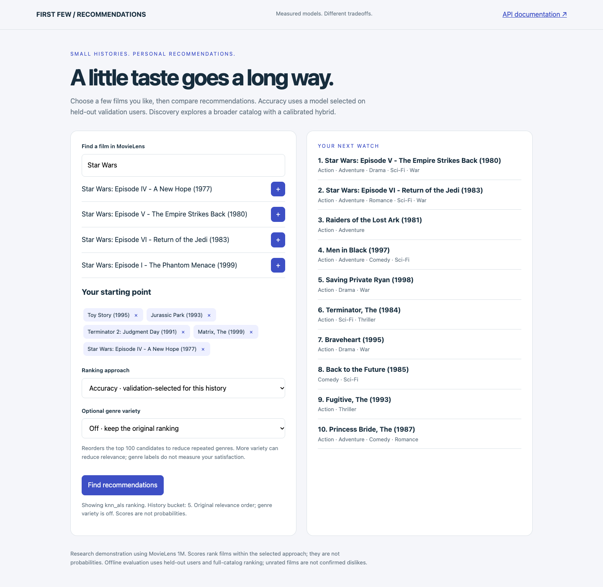
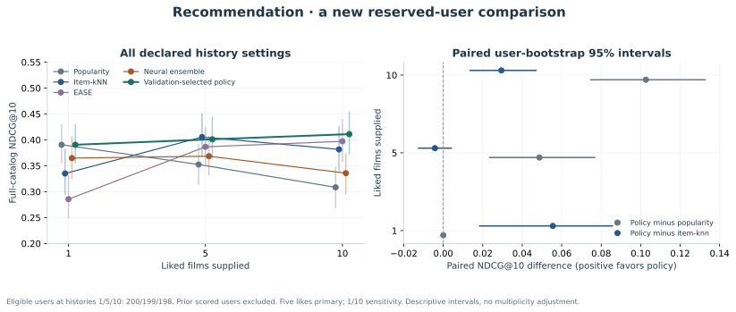
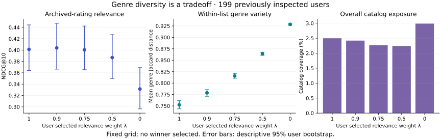
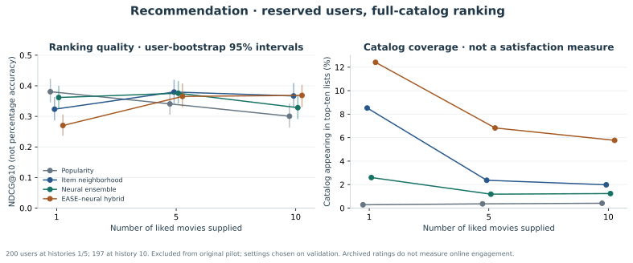

# First Few — a neural recommender for new users

[](https://github.com/adelmansourjr/neural-recommender/actions/workflows/ci.yml)

Compare compact neural models with strong EASE and item-similarity baselines on
MovieLens 1M, then recommend films from a short list of liked movies. Neural user
representations are computed from history; there are no trained user-ID embeddings.
The application exposes validation-selected accuracy ranking, a calibrated
linear/neural hybrid, a discovery mode, and individual baselines.

The repository includes data ingestion, CPU training, reserve-user evaluation,
paired confidence intervals, checkpoint validation, a FastAPI service, an
interactive demo, history-conditional model selection, and offline integration tests. Results depend on history size:
popularity remains strong with one liked film. No state-of-the-art or production
readiness claim is made.

The [leakage and fit audit](docs/LEAKAGE_AND_FIT.md) verifies the recorded user
memberships, train-only features, negative pools and validation-selected defaults.
Poisoning all 800 accessed held-out users leaves fitting inputs unchanged. This
is new-user preference completion with a known catalog: timestamp ties prevent
a strict next-event interpretation. Reused validation can still overfit selection,
and all three original neural curves peak at the five-epoch limit. A separately
frozen [20-epoch convergence diagnostic](docs/CONVERGENCE.md) exactly replays those
prefixes and finds validation gains beyond epoch five. Two seeds reach its fixed
practical plateau; one remains budget limited. No extended models were promoted,
and no new reserve outcomes were inspected. Neural convergence and the absence
of selection overfitting remain unestablished.



## Run independently

Python 3.11 or 3.12, `curl`, and a few hundred MB for CPU dependencies are sufficient.
The dataset is approximately 6 MB. The optimized bundle is about 62 MB, primarily
the dense EASE matrix; the neural models are under 1 MB each.
Run these commands from this project directory:

```bash
python3 -m venv .venv
source .venv/bin/activate
python -m pip install -r requirements-tested.txt -e '.[dev]'
neural-recommender download
neural-recommender optimize --report artifacts/optimized_reproduction.json
neural-recommender refine --report artifacts/refined_reproduction.json
neural-recommender serve
```

Open [the local demo](http://127.0.0.1:8002) and search for films, add a few liked
titles, and request recommendations. The [API reference](http://127.0.0.1:8002/docs)
documents the same inference path. No API keys, GPU, model download, hosted
database, or frontend package installation is needed. On Linux, a CPU-only
PyTorch wheel from `https://download.pytorch.org/whl/cpu` avoids optional CUDA
dependencies; install it before installing this package.

Raw data and trained weights are excluded from Git. A fresh checkout must
run the download and training commands above before starting the service.
Reproduction reports are written under ignored `artifacts/` so the checked-in
historical evidence remains intact. Reproducing an inspected split does not make
its users a fresh test set. The format 3 refined bundle retains preceding models
for rollback and requires no external model download.

The optimized command reproduces a fixed, predeclared protocol: three neural
seeds, 2,500 training users, 200 validation users, 200 reserve test users, five
epochs per seed, and small validation grids for each ranker. It took about
14.5 seconds on the measured local CPU. The original inspected test users are
excluded using the preserved `reports/initial_pilot_metadata.json`; the dataset
digest must match. No additional model weights are downloaded.

For a deliberately new experiment, use distinct protocol and report paths and
declare them before inspecting new results. The original pilot is reproducible
with the earlier command:

```bash
neural-recommender train --seed 42 --epochs 5 \
  --max-train-users 2000 --evaluation-users 200 \
  --artifacts artifacts/pilot --report reports/pilot_reproduction.json
```

`download` verifies cached files using their recorded SHA-256 digest; a changed
or unverified cached file fails rather than being silently accepted. CLI data,
artifact, and report locations can be changed with `--help`.
The same byte budget applies to cached and newly downloaded files. Receipt sizes
and recorded byte counts are checked, and archive digests are streamed rather
than loading the complete file into memory.

Legacy `train` and `optimize` commands deliberately refuse to overwrite a
directory with an active versioned bundle. To reproduce the whole pipeline
without touching the running checkpoint, use a separate directory:

```bash
neural-recommender optimize --artifacts artifacts/reproduction \
  --report artifacts/reproduction/optimized_report.json
neural-recommender refine --artifacts artifacts/reproduction \
  --report artifacts/reproduction/refined_report.json
neural-recommender serve --artifacts artifacts/reproduction --port 8004
```

## History-conditional refinement



The newest [frozen protocol](reports/refinement_protocol.json) keeps exactly the
preceding 2,500 training users, 200 validation users, and three frozen neural
seeds. It excludes **all 400 previously scored pilot/upgrade test users** and
reserves 200 of the **506 remaining** users from the fixed test pool before
fitting new candidates. Older reports are unchanged. Validation has been reused
across research generations, so validation overfitting remains a limitation.

The new baseline is confidence-weighted implicit matrix factorization with
alternating least squares (ALS), using the objective from
[Hu, Koren, and Volinsky (2008)](https://yifanhu.net/PUB/cf.pdf). A new user is
folded into frozen item factors using only the supplied liked films; no held-out
user embedding is trained. Unobserved preference zero/confidence one is an
optimization assumption, not proof that an unrated film is disliked.

The exact predeclared grid consists of four configurations, all with five
iterations and seed 27: `(factors, regularization, alpha)` equal to `(16,10,10)`,
`(32,10,10)`, `(32,10,40)`, and `(32,1,40)`. Five-like validation NDCG@10 selects
**32 factors, regularization 10, confidence alpha 10**. No further search was
performed after the reserve results were viewed.

For each validated history size, a selector compares the fixed pure models and
six predeclared nonnegative blends. Components are standardized per query before
blending. All candidate weights, scores, and chosen settings are recorded in the
[refinement report](reports/refined_benchmark.json) and the
[pre-test selection artifact](reports/refinement_selection.json).

| Liked films | Validation-selected accuracy model | Popularity NDCG@10 | kNN NDCG@10 | ALS NDCG@10 | Adaptive NDCG@10 |
| --- | --- | ---: | ---: | ---: | ---: |
| 1 | Popularity | 0.3906 | 0.3351 | 0.2830 | 0.3906 |
| 5 | 75% kNN + 25% ALS | 0.3525 | 0.4054 | 0.3659 | 0.4012 |
| 10 | 40% kNN + 30% EASE + 20% neural + 10% ALS | 0.3084 | 0.3817 | 0.3724 | 0.4111 |

The primary five-like task includes 199 eligible users. Adaptive minus
popularity is **+0.0487 NDCG@10**, paired 95% interval **[+0.0232, +0.0771]**.
Adaptive minus kNN is −0.0042, with an interval crossing zero
[−0.0128, +0.0044]; the refinement does not establish superiority to kNN on the
primary task. At ten likes (198 users), adaptive minus kNN is **+0.0294**
**[+0.0133, +0.0473]**; adaptive minus popularity is +0.1027
[+0.0745, +0.1329]. At one like (200 users), the selector uses popularity and
therefore ties that baseline rather than forcing a less suitable personalized
model. User-bootstrap intervals are descriptive, conditional on these models,
and not adjusted for multiple contrasts.

The completed CPU experiment took approximately **19.6 seconds** locally.
The whole project remains around **70 MB**, including raw data and artifacts;
new bundle generations hard-link unchanged EASE/neural files rather than copying
them. Quantitative results from different reserve samples must not be compared
as though they were paired; each report contains its own within-sample contrasts.

The default `accuracy` mode and its `adaptive` alias use these history-specific
choices. Intermediate histories select the nearest validated bucket among
one/five/ten, ties lower; histories above ten use the ten-like bucket. Those
intermediate histories were not independently evaluated. The `blend` mode uses
the best validation blend for that bucket even when popularity wins accuracy.
Explicit `als`, `neural`, `ease`, `item_knn`, `popularity`, and previous
`hybrid`/`discovery` modes remain available for transparent comparison.

Format 3 is published through an immutable generation and an atomically replaced
`artifacts/active.json` pointer. Every file is hashed before publication and
reverified before loading; catalog/data/shape compatibility is checked. A running
server keeps its already loaded generation until restarted. `neural-recommender
rollback` restores the previous validated generation, or the legacy format 2
root after the first refinement. The completed report and model pointer are not
a cross-file transaction: publication protects serving completeness, not a
guarantee that a later report write survives every filesystem failure. See
[architecture](docs/ARCHITECTURE.md) and [contributor guidance](CONTRIBUTING.md).

Publication and rollback exclude other pointer writers using
`artifacts/.bundle-writer.lock`; overlapping attempts fail before activation.
Source baseline hashes are checked again against the original verified manifest
after staging, so a source replacement cannot be silently blessed as a new model.
Ordinary failures remove the writer lock. After a process is terminated, confirm
that its recorded PID and every experiment writer have stopped before removing
a leftover lock and retrying.

The completed [serving audit](reports/serving_audit.json) reproduces the frozen
means and catalog coverage for all 12 candidates at each history size. All
**5,970 rankings** across the ten serving modes match independent stable sorting
of the evaluation scores, including history exclusions and returned score values.
This verifies the existing experiment; it performs no fitting, selection, or
evaluation on additional reserve users. Reproduce it after serving-code changes:

```bash
OMP_NUM_THREADS=2 neural-recommender audit-serving \
  --output artifacts/serving_audit_reproduction.json
```

The loader rejects incompatible genre buffers even if a checkpoint hash was
updated, nonnumeric ranker arrays, malformed blend metadata, and overflowing ALS
normal equations. Synthetic tests cover these cases and concurrent model calls.

## Optional genre variety

The demo now lets you explicitly trade relevance against repeated genres without
changing the trained models or the default ranking. Leave **Genre variety: Off**
to obtain the exact preceding results. The API and CLI use
`relevance_weight=1.0` by default. Lower values enable greedy maximal marginal
relevance (MMR), following the relevance/redundancy idea in
[Carbonell and Goldstein (1998)](https://doi.org/10.1145/290941.291025).

For a bounded pool of the first 100 unseen relevance candidates, each step
maximizes `λ × normalized relevance − (1−λ) × maximum genre similarity` to a
previously selected film. Similarity is Jaccard overlap between genre sets.
The first film always has the highest relevance score. Subsequent ties retain
relevance order and then catalog order. At `λ=1`, the original full-catalog
ranker is used directly; at `λ=0`, later selections focus entirely on reducing
genre redundancy. Greedy MMR is a heuristic, not an optimal diversity guarantee.
Returned `score` values remain the original model's relevance scores and can
therefore appear out of descending order after reranking.

```bash
neural-recommender recommend --movie-ids 1 260 1196 --relevance-weight 0.75
neural-recommender evaluate-diversity --output artifacts/diversity_reproduction.json
```

The equivalent `POST /recommend` body is
`{"movie_ids":[1,260,1196],"mode":"accuracy","relevance_weight":0.75}`.
The response describes whether reranking was enabled, its weight, and its
candidate-pool bound. The browser invalidates stale results when the option
changes, just as it does for a changed history or model.

The [predeclared descriptive grid](reports/diversity_protocol.json) uses the
**199 already inspected five-like reserve users**, not a new test sample. It
does not fit weights, select a winner, or alter the default.



| Relevance weight λ | NDCG@10 | Genre list diversity | Catalog coverage |
| --- | ---: | ---: | ---: |
| 1.00 · original | 0.4012 | 0.7524 | 2.50% |
| 0.90 | 0.4039 | 0.7788 | 2.42% |
| 0.75 | 0.4004 | 0.8156 | 2.27% |
| 0.50 | 0.3868 | 0.8639 | 2.24% |
| 0.00 | 0.3314 | 0.9284 | 2.99% |

Genre list diversity is mean pairwise `1 − Jaccard similarity` within each
top-ten list. At `λ=0.75`, its paired improvement is **+0.0632**, 95% interval
**[+0.0568, +0.0704]**; the NDCG change is −0.0008 with an interval crossing
zero **[−0.0091, +0.0071]**. That does not establish equivalent relevance or
improved user satisfaction. At `λ=0.5`, NDCG decreases by **−0.0144**
**[−0.0305, −0.0012]**, and at `λ=0` it decreases by **−0.0697**
**[−0.0918, −0.0483]**. The small observed NDCG gain at `λ=0.9` has an interval
crossing zero. Higher within-list genre variety does not imply higher overall
catalog coverage, as this table demonstrates.

All five grid outcomes, Recall@10, descriptive paired user-bootstrap intervals,
and local reranking latency are retained in the
[complete report](reports/diversity_tradeoffs.json). These intervals are not
multiplicity-adjusted. Genre metadata is a limited proxy for variety and says
nothing about individual preference, demographic fairness, or engagement.
The [default-parity audit](reports/serving_audit_diversity.json) again reproduces
all **5,970 original serving rankings**, with unchanged model/report hashes.

## Optimized reserve-user experiment

The [upgrade protocol](reports/upgrade_protocol.json) records selected user IDs,
the complete candidate grids, seeds, data hash, primary selection task, and a
disclosure that the initial benchmark had already been inspected. It was written
before the upgrade's training and scoring. The reserved test sample excludes
every user in the initial pilot's test sample. This does not make MovieLens an
unseen dataset or remove selection bias in the source ratings.

Changes to the method are substantive:

- EASE solves a regularized zero-diagonal reconstruction problem from training
  interactions. Ridge is selected from 50, 200, and 1,000 on validation NDCG@10.
  This is a linear model, not a neural network. See [Steck, 2019](https://arxiv.org/abs/1905.03375).
- The item-kNN baseline uses cosine co-occurrence similarity with shrinkage;
  shrinkage is selected from 0, 50, and 200, retaining 80 neighbors per item.
- Three neural seeds (7, 19, 42) explicitly include one-, five-, and ten-item
  training prefixes. This corrects the original sampler's mismatch between late
  training prefixes and short cold-start evaluation histories.
- Eight fixed fusion candidates combine standardized EASE, neural-ensemble,
  and log-popularity scores. Validation selected 75% EASE / 25% neural.
- Discovery subtracts a training-popularity penalty from hybrid scores. The
  fixed penalty grid maximizes validation catalog coverage while retaining at
  least 98% of the hybrid's validation NDCG@10; selected penalty is 0.3.

The complete [optimized report](reports/optimized_benchmark.json) records every
validation candidate and all reserve scores. The primary selection task was
five liked films; one and ten are prespecified sensitivity analyses.

| History | Popularity NDCG@10 | Item-kNN NDCG@10 | EASE NDCG@10 | Neural ensemble NDCG@10 | Hybrid NDCG@10 |
| --- | ---: | ---: | ---: | ---: | ---: |
| 1 | 0.3806 | 0.3234 | 0.2632 | 0.3617 | 0.2701 |
| 5 | 0.3408 | 0.3795 | 0.3630 | 0.3756 | 0.3653 |
| 10 | 0.3004 | 0.3667 | 0.3690 | 0.3284 | 0.3685 |



At ten likes the hybrid-minus-popularity NDCG@10 difference is +0.0681
(95% paired user-bootstrap interval [+0.0405, +0.0963]). At five likes the
difference is +0.0245, with an interval crossing zero [−0.0069, +0.0529].
At one like the hybrid is worse by −0.1105 [−0.1449, −0.0755]. These results
support a history-dependent tradeoff, not universal neural superiority.

The neural ensemble itself improves over popularity at the primary five-like
task: +0.0348 NDCG@10, paired interval [+0.0131, +0.0517]. At ten likes its
difference is +0.0280 [+0.0101, +0.0447]; at one like it is −0.0189 with an
interval crossing zero [−0.0491, +0.0091]. These isolate the neural contribution
from EASE and do not imply that the hybrid beats EASE at ten likes: that paired
interval crosses zero. The extra neural/kNN paired intervals were calculated
after the primary report from unchanged checkpoints and the same users, with no
model or setting changes. Comparisons are descriptive and not multiplicity-adjusted.
There are 200 eligible users at histories one/five and 197 at history ten.

At five likes, catalog coverage is 0.36% for popularity, 6.82% for hybrid,
and 6.95% for discovery. Discovery NDCG@10 is 0.3652, close to hybrid's
0.3653 in this sample. The report also includes long-tail share (outside the
training-popularity top 20% of the catalog), per-seed results, Recall@10, and
paired hybrid-versus-EASE intervals. Catalog coverage is not a direct measure
of user satisfaction or within-list diversity.

**Serving selection correction:** the first optimized code selected the best
fusion but did not compare it with the separately tuned kNN baseline when choosing
the default accuracy mode. This was corrected after reserve scores were produced:
the default now picks the best validation candidate across popularity, kNN, EASE,
neural ensemble, and hybrid. The selected default is **item-kNN**, with validation
NDCG@10 0.3655 versus hybrid 0.3456. No model or hyperparameter was changed after
reserve inspection. The original optimized report is retained as
`reports/optimized_initial.json`, and the correction's timing is explicitly
recorded in the current report. New runs compute this full selection before
reserve evaluation. Hybrid and neural modes remain explicit UI options.

## Preserved original pilot

The preserved [initial report](reports/initial_pilot.json) was produced on the local CPU
with seed 42, 2,000 training users, 29,316 training examples, 200 validation users,
200 test users, and five epochs. The model has **126,976 parameters**. Training
and evaluation took approximately **4.8 seconds** in that run; timings vary by
machine. Test users were not involved in gradient updates or epoch selection.

| Liked-film history | Popularity NDCG@10 | Neural NDCG@10 | Popularity Recall@10 | Neural Recall@10 |
| --- | ---: | ---: | ---: | ---: |
| 1 | 0.4236 | 0.2836 | 0.0674 | 0.0432 |
| 5 | 0.3761 | 0.3404 | 0.0606 | 0.0549 |
| 10 | 0.3416 | 0.3266 | 0.0517 | 0.0554 |

At five liked films, the paired neural-minus-popularity NDCG@10 difference is
−0.0356, with a 95% user-bootstrap interval of [−0.0662, −0.0069]. The pilot
therefore does **not** show superior neural ranking accuracy. Neural catalog
coverage at this history size is 2.42%, compared with 0.36% for popularity.
Coverage is the fraction of the entire movie catalog appearing in any top-ten
list among the evaluation users; it is not a diversity or satisfaction guarantee.

The initial report also includes a genre-similarity baseline, separate user-bootstrap
intervals for each metric, paired deltas, the learning curve, dependency versions,
and dataset digest. One seed and a small evaluation-user sample do not establish
model-family superiority. No hyperparameter search was conducted after inspecting
that test report. The upgrade above uses an explicit reserve-user protocol. A future comparison needs to
plan and report repeated seeds rather than tuning to these numbers.

## What the model learns

1. An item encoder combines a 32-dimensional movie embedding with projected
   genre features, then normalizes its output.
2. A user encoder mean-pools the liked items in the history, applies a small
   learned projection, and normalizes the resulting representation.
3. Neural training uses sampled softmax over a target positive and five unobserved
   items. Unobserved items are training negatives, not known dislikes.
4. Individual rankers or their selected fusion score the full catalog and exclude
   supplied history films. EASE and kNN derive their coefficients from training
   users only. Scores are not click probabilities.

The history encoder mean-pools rather than models ordering. Histories are drawn
from each user's earlier positive ratings; chronology determines membership, not
a recurrent hidden state. Up to twenty supplied liked films are accepted by the
current checkpoint, consistent with its training-history limit.

## Evaluation protocol

The following describes the original pilot. The upgrade keeps the user-disjoint
principle but fixes train/validation/reserve memberships in its protocol file,
uses three neural seeds and short-prefix training, and adds closed-form baselines.

- Shuffle users once with the recorded seed into 70% training, 15% validation,
  and 15% test pools; select the declared user subsets from those disjoint pools.
- A rating of at least four stars is a positive. Sort each user's positives by
  timestamp, with movie index as a deterministic tie-breaker. Timestamp ties do
  not establish a real within-session order.
- For training users, construct at most fifteen prefix/next-positive pairs,
  retaining at most twenty historical positives per pair. Training-only users'
  entire observed histories exclude candidate negatives, including low ratings.
- For a held-out user, reveal the first one, five, or ten positives and treat
  the remaining positives as the relevant set. Exclude supplied history items
  and rank **all other catalog items**, not sampled candidate subsets.
- Select the epoch using validation NDCG@10 with five history items. Evaluate
  test users after checkpoint selection. Users with insufficient positives for
  a history setting are excluded and their evaluated counts are reported.
- Bootstrap users, not individual recommendation slots. Paired comparisons use
  the same user resamples for both methods. These intervals describe uncertainty
  conditional on this model and split, not uncertainty across training seeds.

This is **user cold start**, not item cold start or a global chronological
deployment simulation. Catalog metadata is available for every movie. Unobserved
recommendations are not established false positives, and ranking archived ratings
does not measure real online engagement. MovieLens 1M reflects an older, selected
population of active movie raters; it is not a representative current audience.

## Project layout

```text
src/neural_recommender/
  data.py        validated archive ingestion and reproducible user splits
  model.py       item and history encoders
  training.py    sampled training, validation selection, final evaluation
  baselines.py   EASE, shrinkage kNN, score fusion, novelty ranking
  optimization.py frozen reserve protocol and multi-seed comparison
  als.py         confidence-weighted factorization and new-user fold-in
  conditional.py validation-selected history buckets and score blends
  diversity.py   opt-in bounded genre MMR and interpretable list-diversity metric
  diversity_evaluation.py fixed descriptive tradeoff grid, no model selection
  refinement.py  second reserve protocol and bounded ALS/selector experiment
  bundles.py     verified immutable generations, atomic pointer, rollback
  audit.py       frozen-metric reproduction and independent serving rank checks
  metrics.py     full-catalog ranking and paired user bootstrap
  service.py     verified checkpoint inference
  api.py         local HTTP interface
  http_guard.py  streamed request cap and non-sensitive response trace metadata
  cli.py         download, train, and serve commands
  storage.py     atomic JSON and TLS-verified bounded downloads
  static/        dependency-free browser demo
tests/           network-free numerical and integration tests
reports/         measured experiment report, safe to version
data/            ignored upstream archive and receipt
artifacts/       ignored trained weights and provenance metadata
```

The service requires a trained checkpoint, checks its format and digest, verifies
the dataset digest and movie ordering, and uses `torch.load(weights_only=True)`.
It fails on missing or incompatible artifacts rather than generating random
recommendations. Hashes check consistency, not the authenticity of artifacts from
an untrusted distributor. The default server binds only to the local machine;
public deployment would additionally need authentication, resource controls,
monitoring, and a review of the data-use terms.

The local server caps concurrency at sixteen connections and rejects request
bodies above 256 KiB before JSON parsing, including streamed bodies with a
missing or inaccurate `Content-Length`. Responses carry a request ID and timing
header; application logs record method, path, status, duration, and request ID
without logging query strings, request bodies, or recommendation results. The
demo page has a same-origin content security policy, and model responses use
`Cache-Control: no-store`. These controls bound the local demo; they do not add
authentication or establish a public-service capacity guarantee.

The NumPy scoring path uses explicit finite-checked row contractions. This avoids
spurious floating-point flags observed in Apple Accelerate's float32
matrix-vector dispatch in the tested NumPy version; a regression test compares
it with scalar reference scores without suppressing numeric warnings.

## Verify changes

```bash
ruff check .
ruff format --check .
pytest -q
```

The tests cover disjoint splits, temporal prefix/target separation,
padding invariance, known ranking metrics, finite numerical scores, malformed
data, strict request validation, real tiny-model training, checkpoint round-trip,
API inference, tampered datasets/weights, unsupported artifact versions, zero
diagonals in EASE, no self-kNN contribution, train-only co-occurrences, reserve
exclusion, fusion weight checks, all serving modes, and validation-only default
selection. `pytest -q` reports the current exact count.
Additional tests cover ALS weighted normal equations and finite solver inputs,
the second reserve exclusion set, malformed active pointers, incomplete manifests,
format migrations, every format 3 serving mode, atomic publication, rollback,
and refusal to interpret booleans/strings as artifact-format versions.
Tests generate synthetic fixtures and require no network or MovieLens download.
A standalone GitHub Actions workflow runs these checks on Linux with Python 3.11
and 3.12, validates dependency consistency, and builds a wheel. The local
Starlette version emits an upstream deprecation warning about its test HTTP
client; it does not affect the passing assertions.

## Next research experiments

The history-conditional selector and regularized ALS comparison above are
completed experiments. Further accuracy work should begin with a new frozen
protocol rather than additional tuning against these inspected reserve users.
Useful separate questions include globally chronological evaluation,
metadata-only recommendation for unseen items, and outcomes measured with a
current, consented user population. None is measured by the present benchmark.

See the [hardening record](reports/HARDENING.md) for the completed artifact and
serving audit, verification commands, and the remaining evaluation limits.

See [DATA_LICENSE.md](DATA_LICENSE.md) for upstream terms and citation. The MIT
software license does not replace the dataset's research-use conditions.
