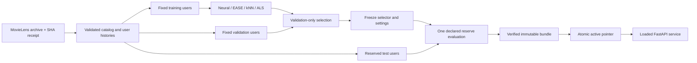

# Architecture and invariants

The system separates dataset interpretation, model fitting, model selection,
publication, and inference. It is a local research application with reproducible
benchmarks, not an internet-facing production service.

## Data and evaluation boundaries

`data.py` validates archive sizes, unique movie IDs, rating ranges, and unique
user/movie interactions before producing deterministic sequences. Ratings of
four or five stars are positives. Timestamp ties are resolved deterministically
by movie index; that order is not an observed within-session sequence.
This loader supports at most 10,000 movies, 1.5 million ratings, and 128 genres;
catalog and genre limits are checked before allocating dense feature arrays.
Titles and genre labels also have bounded, nonempty display strings.

Each experiment protocol records user IDs and the dataset digest. Training,
validation, and test users are disjoint. The first upgrade and the subsequent
refinement explicitly exclude preceding inspected test samples. The refinement
keeps training/validation memberships unchanged and fits ALS only from training
users. Source bundle/protocol digests ensure that fixed preceding models are the
ones being reused. Reusing validation across experiments can still overfit it.
Cached protocols reconstruct the complete deterministic memberships and grids
before use; matching the dataset/config alone is insufficient. `isolation.py`
rejects duplicate, coerced, boolean and wrong-split IDs. The
[leakage audit](LEAKAGE_AND_FIT.md) counterfactually changes all accessed held-out
interactions and negative maps and checks the exact production input builder for
all three seeds without fitting. It binds source, protocol, selection and model
hashes; its successful checks do not attest to a historical training execution.

Ranking evaluates the full catalog after excluding supplied liked-history items.
It measures archived-rating relevance, not user satisfaction or causal response.
An unrated movie is not a known dislike. The system studies new **users**, not
new catalog items or a globally chronological launch. Catalog metadata is known
for every item.

## Model contracts

- `model.py`: a shared item encoder combines learned item vectors and genre
  projections. A mean-pooled, masked history feeds a small user tower. Padding
  contributes zero to the pooled history. No user-ID parameter table exists.
- `baselines.py`: EASE uses a zero-diagonal ridge reconstruction; kNN retains
  bounded neighbor lists after train-only co-occurrence/shrinkage. Their strong
  results remain in the report even when neural models do not win.
- `als.py`: confidence-weighted implicit ALS solves positive-definite normal
  equations with regularization. New users are folded into frozen item factors.
  Public fold-in validates finite factors, positive finite regularization and
  confidence, index bounds, and optional cached Gram shape/symmetry/finiteness
  before the low-level solver is called. Constructed normal equations are checked
  again because finite input factors can still overflow a contraction. Invalid
  systems fail explicitly rather than passing nonfinite values to LAPACK.
- `conditional.py`: candidate weights are nonnegative and sum to one. Pure
  candidates retain their score units; mixtures standardize component scores
  per query. The selector records exact weights for one/five/ten histories.
  Intermediate lengths use a documented nearest bucket and carry no separate
  performance guarantee.
- `metrics.py`: finite-checked row contractions avoid the observed NumPy/Apple
  Accelerate warning issue. Stable ties, history exclusion, and paired-user
  bootstrap are shared between evaluation and service tests.

The refinement tunes four ALS configurations, then the frozen blend grid.
Five likes is the primary task; one and ten are sensitivity analyses. Selection
is completed and written before new reserve scoring. Multiple contrasts use
descriptive intervals without multiplicity correction, and the earlier neural
seed ensemble does not quantify split uncertainty.

## Serving and artifact formats

`RecommenderService` resolves an active generation once, verifies every required
digest, then validates dimensions, catalog ordering, data identity, factor
finiteness, EASE diagonal, kNN index bounds, and selector metadata. PyTorch loads
use `weights_only=True`; NumPy loads use `allow_pickle=False`. Hashes establish
internal consistency rather than authenticity of a downloaded bundle.

Supported formats are explicit:

| Format | Capabilities | Compatibility behavior |
| --- | --- | --- |
| 1 | Original neural pilot | Neural/accuracy modes only; unsupported modes fail clearly |
| 2 | Neural ensemble, EASE, kNN, fixed hybrid/discovery | Historical accuracy winner remains available |
| 3 | Format 2 plus ALS and history-conditional selection | Active pointer resolves an immutable generation |

Unknown versions, coerced booleans/strings/floats, missing members, nonfinite
arrays, incompatible catalogs, and invalid selector references are rejected.
The neural genre buffer must exactly match the verified catalog, not merely have
the expected dimensions. Real numeric array types and derived item vectors are
validated; hash consistency alone does not imply semantic compatibility.
The loader never supplies random weights as a fallback. The API exposes the
actual selected ranker and history bucket; scores are not probabilities.

Optional `relevance_weight` reranking runs after that selected model scores the
catalog. At the default value one, the exact historical full-catalog rank path
remains in use. Lower values build at most 100 unseen relevance candidates and
greedily select at most 50 using normalized relevance and maximum genre Jaccard
redundancy. The first candidate remains the relevance winner; deterministic ties
use relevance order and catalog order. Pairwise genre memory is at most 100×100,
independent of the larger catalog. Score normalization scales finite values
before subtraction to avoid overflow on extreme direct-call inputs.

Reranking does not modify relevance scores, model selection, feature buffers, or
the trained artifacts. API metadata explicitly describes the order change;
returned scores retain their original model units. The user chooses the weight,
and the default remains unchanged. Genre overlap is a metadata proxy rather than
a satisfaction, fairness, or global catalog-exposure objective.

`publish_bundle` writes a staging generation, verifies its manifest, renames the
directory, and atomically replaces `active.json`. On supported local filesystems,
readers see a complete old or new generation. Unchanged arrays are hard-linked
where possible. Legacy writers use atomic file replacement rather than truncation
so those links cannot be mutated by a later experiment. Legacy training commands
refuse to target a directory with an active bundle.

Copied or linked baseline bytes must match the hashes verified in the source
manifest before staging. Computing a new destination digest alone would silently
accept a source path replaced during publication. Model identity fields also
remain tied to that source. Refinement takes its source path from the exact
generation already loaded by the service, so activating another generation cannot
mix a separately resolved source path with the in-memory fitting inputs.

`previous.json` records a validated rollback destination. A running service holds
one generation in memory; restart after activation or rollback. An exclusive
`.bundle-writer.lock` prevents publication and rollback from interleaving their
pointer changes; a conflicting operation fails before changing serving state.
The lock is removed on ordinary success or failure. A terminated process can
leave it behind: confirm the recorded process and any other experiment writer
have stopped before removing that lock and retrying. This intentionally fails
closed rather than guessing whether an old lock owner is alive.

The completed report and activation pointer are not a cross-file transaction,
and legacy training commands do not participate in this publication lock. Use
separate directories for legacy training and preserve the protocol, report,
source bundle, and data receipt together.

## API and frontend

`api.py` validates strict JSON integers, unique known movie IDs, bounded history,
mode, and response count. `service.py` repeats critical checks for non-HTTP callers.
Search length and result count are bounded. The application serves its HTML,
JavaScript, and CSS under the same local origin with no remote frontend dependency.
The default server binds to loopback. Authentication, request quotas, monitoring,
and a data-license review are required before public deployment; none are claimed
by this local prototype.

`http_guard.py` bounds the actual streamed request body at 256 KiB before JSON
parsing, independent of the declared content length. The CLI also configures a
sixteen-connection Uvicorn concurrency limit. Non-static responses disable
caching; response metadata includes a generated request ID and timing header.
Structured application log fields contain method/path/status/duration/request ID,
excluding query strings, bodies, and result contents. The demo page uses a
same-origin content security policy. These are local resource and diagnostics
controls, not authentication or a measured multi-tenant service guarantee.

## Reproducibility and maintenance

Retain the exact raw-data digest, protocol IDs/grids, source artifact hashes,
selected settings, dependency versions, report, and bundle manifest. Wall-clock
time is a local observation, not a throughput guarantee. Tests run on synthetic
fixtures without network and include numerical-reference, leakage-boundary,
serialization, API, migration, rollback, and tamper cases. Large checkpoints and
licensed raw data stay out of Git; code, protocols, and aggregate results are
reviewable without them.

`audit-serving` checks the deployed generation against an existing frozen report.
It reproduces all twelve candidate means/coverage at histories one/five/ten, then
compares every serving mode with independently sorted reference scores. It also
verifies source-artifact digests and records the frozen report digest. This is a
reproduction of already inspected users; it fits nothing and is not a new test
sample or an opportunity to tune settings. Concurrent-request tests exercise
shared inference state without requiring another real dataset evaluation.
