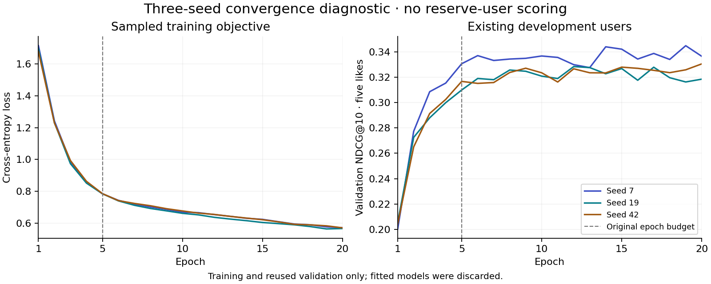

# Validation-only convergence diagnostic

The active recommender passes its recorded user-isolation checks, but its neural
training budget is **not certified as converged**. A new, predeclared 20-epoch
diagnostic found useful gains beyond the original five epochs on the existing
validation users. Two seeds meet a practical plateau rule at the larger budget;
the third still selects epoch 20. This is concrete evidence of budget sensitivity
in the neural component, rather than proof of either optimal fitting or new test
performance. The active recommender and its published metrics are unchanged.

## Prospective design and isolation

The [frozen protocol](../reports/convergence_protocol_2026_10_23.json) was written
at **2026-10-23 11:22:47 UTC**, before fitting started. It binds the original
dataset, source files, runner, runtime, three seeds, ordered development owners,
historical learning-curve report and every file in the active model generation.
Execution refuses drift in these identities before fitting and checks them again
before saving a result. Protocol and result paths cannot overwrite existing files.

The diagnostic uses the original **2,500 training users** and **200 validation
users**, of whom 199 have more than five positive ratings. It physically removes
all other owners' interactions before constructing any histories, targets or
negative pools: **555,528 rating rows are excluded**, leaving 444,681 development
rows. Only training owners supply gradient examples or observed-item negative
exclusions. The catalog remains available as in the documented existing-item
task. No reserve-user recommendations or metrics are computed.

The original neural trainer is reused without changing its input sampler,
architecture, optimization parameters or ranking evaluator. Each of seeds 7, 19
and 42 runs for **exactly 20 epochs**. All ten loss/validation measurements in each
seed's first five epochs reproduce the preserved experiment **exactly**, with
maximum absolute deviation 0.0. This checks that the extension is a comparable
replay rather than a changed model or split.

## Fixed rule and observed results

The practical plateau rule was fixed in advance: minimum 10 epochs, patience 5,
and a validation NDCG@10 improvement greater than **0.002** to advance the
improvement anchor. All 20 epochs execute even after a temporary plateau. A
terminal plateau requires five epochs without an improvement over that anchor
larger than 0.002. An exact best epoch is recorded separately; small improvements
below the practical threshold can still create a later best checkpoint.

| Seed | Best within original 5 epochs | Best within fixed 20 epochs | Best epoch | Practical plateau at epoch 20 |
|---|---:|---:|---:|---|
| 7 | 0.330620 | 0.344826 | 19 | Yes |
| 19 | 0.309897 | 0.328363 | 12 | Yes |
| 42 | 0.316677 | 0.330480 | 20 | **No: budget limited** |

Training cross-entropy falls from 1.68–1.71 at epoch 1 to 0.566–0.571 at epoch
20. Validation quality is not monotonic: seeds 7 and 19 finish below their best
validation epoch while their training loss continues to fall. The result supports
validation checkpoint selection and a bounded stopping policy. A lower training
loss alone does not justify a longer budget. The plot records the complete curves:



The [completed report](../reports/convergence_diagnostic_2026_10_23.json) contains
all 60 epoch records, prefix reproduction checks, fixed-rule decisions and scope
limits. Execution took **35.1 seconds on CPU** with two Torch threads. Models were
discarded after their curves were read. No weights were saved, no active model
files changed, and zero reserve users were scored.

## What can be signed off

- **Pass:** exact training/validation owner isolation for this diagnostic,
  reproducible original prefixes, bounded computation, preserved artifacts and
  honest retention of a nonconverged seed.
- **Qualified:** a practical validation plateau for seeds 7 and 19 under this
  specific rule. This is not a statistical equivalence test or a proof of a global
  optimum, and does not certify the active five-epoch neural models as converged.
- **Not established:** a terminal plateau for seed 42, generalization gains from
  the extended models, globally chronological deployment performance, or absence
  of selection overfitting. The validation users were already reused across
  model generations and cannot provide a fresh confirmatory estimate.

Training cross-entropy and full-catalog ranking NDCG have different objectives;
subtracting them does not produce a generalization gap. Repeated seeds share
the same split and do not measure split uncertainty. A future promoted neural
generation needs its own frozen development policy and genuinely fresh final
evaluation data. These results must not be used to optimize previously inspected
reserve results. Existing serving defaults retain their original evidence; in
particular, the five-like adaptive default uses kNN plus ALS, not these neural
weights.

## Reproduce

From this repository root, with the environment activated, downloaded data,
and an active refined bundle:

```bash
python scripts/convergence_diagnostic.py freeze \
  --protocol artifacts/convergence_protocol_rerun.json
python scripts/convergence_diagnostic.py run \
  --protocol artifacts/convergence_protocol_rerun.json \
  --output artifacts/convergence_diagnostic_rerun.json
python -m pytest tests/test_convergence.py -q
```

The new protocol captures the current runtime and source identities. It still
requires the original first-five learning curves to reproduce within the fixed
absolute tolerance of 1e-10; differing numerical runtimes fail comparison rather
than silently relaxing this check. Figure regeneration uses the completed,
checked-in report. The plotting dependency is optional; install and run it with:

```bash
python -m pip install -e '.[analysis]'
python scripts/plot_convergence.py
```
